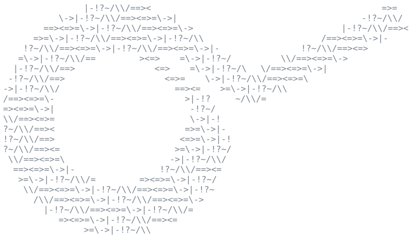

<p align="center">
  
</p>

<h1 align="center">Symbolum</h1>

<p align="center">
  <strong>A computer algebra system and a proof assistant, the first proposes and the second
  checks.</strong>
</p>

<p align="center">
  <a href="https://github.com/angleto/symbolum/actions/workflows/ci.yml"></a>
  <a href="https://www.scala-lang.org/"></a>
  <a href="LICENSE"></a>
</p>

**EXCERPT — for anyone scanning the index:**
What the two halves of this system are, how to run each, and what the proof side can and cannot
state today. The algebra half is documented in full here. The proof half has a guide of its own in
[docs/proving.md](docs/proving.md); its design is in [docs/architecture.md](docs/architecture.md)
and the decisions behind it are in [docs/adr/](docs/adr/). This file does not explain the kernel.

*If you modify this file and this excerpt no longer accurately describes its content, you must
update it.*

## Two halves

| | What it does | Is it trusted? |
|---|---|---|
| **Algebra** — `modules/core` | Simplifies, expands, differentiates, integrates, solves. Fast, heuristic, and wrong in ways this repository has measured. | **No.** Nothing it says is believed anywhere on the proof side. |
| **Proof** — `modules/kernel`, `modules/logic`, `modules/theories` | States and proves theorems in higher-order logic, over the naturals and over the reals. Slow, narrow, and certain. | **Two things:** the kernel, and the axioms of whichever development you build on. The table below counts those axioms. Nothing else in this repository is trusted. |
| **The bridge** — `modules/tactics` | The algebra proposes an answer; the proof side certifies it or refuses. | It is the **lowest** module that sees both halves, and the boundary is about what lies below it rather than about what is unique to it: `kernel`, `logic` and `theories` cannot see `core` at all. The module graph is what holds that, and `IsolationSpec` asserts it at the kernel. `examples` is above `tactics` and sees both too, calling what the bridge publishes rather than adding to it. |

The arrangement is the point. A simplifier that carried every side condition would be unusable, so
this one does not carry them: several of its rewrites hold only for positive arguments or non-zero
factors, and [`ValuePreservationSpec`](modules/core/src/test/scala/garden/xeno/symbolum/ValuePreservationSpec.scala)
pins each one by example with the value it changes. That costs nothing as long as nobody believes
it, and the bridge is what makes it possible not to.

### What each development asks you to believe

Counted from the code rather than written here, because these figures went stale once already:
the row for the naturals said two and the row for both said eighteen from 2026-09-10, when eta
landed, until 2026-09-14. Regenerate with
`sbt "theories/runMain garden.xeno.symbolum.theories.Foundation"`; `FoundationSpec` fails when the table
and the code disagree.

<!-- generated: trusted-base, do not edit below this line -->

| A development built on | Axioms it asks you to believe | Which they are |
|---|---|---|
| the reals alone | 16 | a complete ordered field, listed in `Real.scala` and in [docs/lemmas.md](docs/lemmas.md) |
| the naturals alone | 3 | `ETA`, `INFINITY`, `SELECT` |
| both, which is what the standard chain assembles | 19 | the two rows above, added, since they share none |

<!-- end generated: trusted-base -->

## Quick start, both halves

```bash
sbt test                      # the whole suite, every module
sbt core/console              # a console with the algebra loaded
```

Algebra, which believes nothing and proves nothing:

```scala
import garden.xeno.symbolum._, garden.xeno.symbolum.Dsl._

val x = Var("x")
((x + 1) ^ Num(2)).expand()          // x^2 + 2*x + 1
Derivative(Sin(x ^ Num(2)), "x").simplify()   // 2*x*cos(x^2)
```

Proof over the reals, which believes the axioms of a complete ordered field and proves the rest:

```scala
import garden.xeno.symbolum.theories._

Ring.standard.prove("!x:real y:real. (x + y) * (x + y) = x * x + 2 * (x * y) + y * y")
// Right(|- !x:real. !y:real. (x + y) * (x + y) = x * x + 2 * (x * y) + y * y)

Linarith.standard.prove("!x:real y:real. x < y ==> x + 1 < y + 1")
// Right(|- !x:real. !y:real. x < y ==> x + 1 < y + 1)

Arithmetic.standard.multiply(3, 4)
// Right(|- 3 * 4 = 12)      proved from the axioms, not computed
```

And the two together, which is what the repository is for:

```scala
import garden.xeno.symbolum.tactics._

Oracle.standard.certifyExpansion((x + 1) * (x + 1))
// Right(Certified((x + 1) * (x + 1) --expansion--> x^2 + 2*x + 1, |- ... ))

Oracle.standard.certifyIdentity(x + x, Num(3) * x)
// Left(could not certify x + x = 3 * x: ...)     the oracle is trusted for nothing
```

## What the proof side can and cannot state

Honest, because the boundary is invisible from the code and a proof assistant that hides it wastes
the reader's time.

| | Status |
|---|---|
| Higher-order logic, connectives, quantifiers | Yes, all definitional, no axioms |
| The real numbers as a complete ordered field | Yes, on the axioms the table above counts, listed in one file |
| The natural numbers, induction, recursion, finite sums | Yes, on the axioms the table above names, two of which the classical logic underneath asks of the formalism rather than of a domain. `num` itself is a defined type and costs no axiom, so induction, Peano's other axioms and the recursion theorem are derived rather than assumed |
| Binary numerals, addition and multiplication on them | Yes, proved digit by digit |
| Polynomial identities over the reals, with subtraction | Yes, `Ring` |
| Linear inequalities, and products of the hypotheses up to degree three | Yes, `Linarith`, which finds the multipliers itself; degree four is the limit |
| Division, the multiplicative inverse | Yes, `Field`, which pays the axiom's antecedent by handing `~(x = 0)` back as a hypothesis on the theorem |
| The order on `num`, its predecessor and its truncated subtraction | Yes, `Peano`, which also embeds `num` into the reals. Truncated is the only subtraction `num` can have and the lemmas say so where a reader meets them: `NUM_SUB_EQ_ZERO` is `NUM_LE x y ==> NUM_SUB x y = 0`, and `NUM_REAL_SUB` carries a difference over to the reals under the hypothesis that makes it honest |
| Divisibility, congruence, division with remainder, the greatest common divisor, Bezout, Euclid's lemma, the Chinese remainder theorem | Yes, `Modular`, over `num` and not over the reals. The statement that measures the difference is `NUM_DIVIDES a b /\ NUM_DIVIDES b a ==> a = b`, a theorem here and false over a field, where every non-zero `a` divides every `b` |
| The primes, as results rather than as infrastructure | Yes, `Primes`. `NUM_PRIME_UNBOUNDED` is Euclid's theorem, which is what "there are infinitely many primes" says in a logic with no notion of an infinite set, and `NUM_SQUARE_NOT_DOUBLE` is the arithmetic content of the irrationality of the square root of two. It is **not** that sentence: there is no square root on the reals here, so the classical statement cannot be written |
| Strong induction, and recursion whose step may read every earlier value | Yes, `Peano.NUM_STRONG_INDUCTION` and `Descent`, both derived and costing no axiom. `Recursion` reads one value back, which is the wrong shape for a predicate about a code whose parts are smaller numbers rather than predecessors |
| A claim about every number below a **concrete** bound | Yes, `Bounded`, by proving the instances and assembling them, one case split per step. It does not compute, and `docs/adr/0010` is why nothing here can: the bound is read as a term and walked as a term |
| Pairs, finite words and their rotation, 2x2 matrices over the reals | Yes, `Product`, `Word`, `Rotation` and `Matrix`. `prod` and `word` are types carved out by a predicate and cost no axiom; a matrix is a pair of pairs and gets no type of its own, which `Matrix` argues rather than assumes |
| `max`, `min`, `abs`, `sgn` | Yes, `Magnitude`, and it is the choice axiom's first use outside the foundation. A proof that a greatest of two exists is not a term naming it, and `select` is the only thing that stands between the two |
| Sequences, convergence, the limit of one | Yes, `Limit`, and both constants are definitions: `converges s l` is the epsilon-N statement written out, and `lim s` is chosen the way `NUM_GCD` is, pinned by `CONVERGES_UNIQUE` wherever the sequence converges and silent where it does not |
| The exponential, the sine, the cosine, the logarithm, `sinh` and `cosh` | Yes since 2026-09-15, as **definitions** and no axiom, which `docs/adr/0017` decides against asserting an axiom apiece. `exp`, `sin` and `cos` are the limits of their power series, `ln` is the inverse of `exp` named by choice, and the hyperbolic pair is built from `exp`, which is the one divergence and is recorded in the same place. What is **proved** of them is the value of each at zero, plus `cosh x + sinh x = exp x` and its twin, which are what defining the pair from `exp` buys. The row below is why that is all |
| A numeral at either type that has one, `real` or `num` | Yes, and the context decides which, not the parser: `docs/adr/0012`. A numeral nothing determines is refused, `2:num` and `2:real` are the escape, and `Successor` is what opens a written numeral into successors so that a recurrence over `num` can fire on it |
| The syntax of Peano arithmetic as numbers: terms, formulas, substitution, where a variable occurs free, the axioms of PA and of first-order logic with equality, and a provability predicate | Yes, `Numbering`, `Language` and `Provability`, over `Coding`'s beta function, which makes a finite sequence two numbers so that no definition of a derivation has to walk one. `NUM_PROV` is inhabited and closed under modus ponens and generalisation, which with the schemes are the whole Hilbert system |
| Derivations of that embedded theory, and the deduction theorem for it | Yes, `Deduction`, which declares nothing and holds the rules the theorem is assembled from, one per way a step can be justified. Its hypothesis must be a formula in which no index occurs free, and `Language.notFreeIn` walks a concrete code through the freeness clauses to discharge exactly that, so the theorem applies to formulas somebody can name: `DeductionSpec` applies it to an axiom of PA with both conditions discharged and no hypotheses left |
| A theory of a domain that is not mathematics, and what a claim about it rests on | Yes, and `DomainTheorySpec` is one: a type and constants nothing else has, the four sentences of a release gate asserted as axioms, and a conclusion that spends one of them and no foundational axiom at all. `Derivation.axiomsOf` is what answers, and `Derivation.foreignTo` separates the domain's assumptions from the foundation's. What a domain gets of automation is the propositional skeleton and not the domain: `Ring` and `Linarith` decide fragments of the reals and have nothing to say about an arbitrary axiom, but the same claim is settled a second time by `Propositional`, same theorem and same one domain axiom, at one foundational axiom the hand derivation does not spend. The caller still specialises and detaches the axiom itself |
| Proof terms, an independent checker | Yes, `modules/checker`, which replays a theorem's derivation as serialised text or in this process and calls no kernel rule to do it |
| Applying a lemma the development holds, working out its instance from the goal | Yes, `Apply`, and the prover asks its library before it asks a procedure. Since 2026-09-15 it also **chains** them: a lemma that would settle the goal at the cost of an obligation is no longer turned away, the obligation becomes a subgoal, and `Chaining` bounds how far that goes. The row below says what that is and is not |
| Instantiating a lemma whose parameter is a **predicate** | Yes, on the Miller fragment: a variable applied to distinct bound variables has one answer and the matcher gives it. This is what makes the completeness axiom usable; full higher-order unification is undecidable and is not here |
| The integers and the rationals | **No.** `docs/adr/0007` is the order they arrive in, and `docs/adr/0016` is what does not wait for them |
| Goedel's theorems, the diagonal lemma, D1, D2 and D3 | **No**, and what is missing is one level rather than a heap of arithmetic. All of them are about formulas **of the object language**: the diagonal lemma substitutes a formula with one free variable into itself, and the three conditions are statements about `Prov` written as such a formula. What exists is `NUM_PROV`, a predicate of the ambient logic about codes, so none of the four can be stated yet. `docs/adr/0013` is the target and the order |
| Evaluating a defined function at concrete arguments: a gcd, a quotient, a remainder, a floor | **No**, and it is not the numeral row above read twice. `docs/adr/0010` decides that there is no computing rule in the kernel, so `12 * 12 = 144` is a derivation through the axioms of the ring rather than a calculation; these constants do not have even that, being chosen with `select`: they denote, they are characterised by lemmas, and nothing calculates one. `NUM_DIV_MOD_UNIQUE` is the route a hand derivation takes, one value at a time. A gcd anybody can compute wants Euclid's algorithm, which is a definition by well-founded recursion and is not here |
| That a sequence converges, where it is increasing and bounded | Yes since 2026-09-15, `Limit.MONOTONE_CONVERGES`, and it is the first thing here that **obtains** a limit rather than taking one as a hypothesis. It is where `COMPLETENESS` is spent the second time, which `LimitSpec` asserts by name rather than by a count. `Classical.NOT_FORALL` landed with it: the step "the supremum would not be least" is a negated universal turned into a witness, and this logic had no rule for it |
| That a **series** converges, and every fact that needs it | **No.** A series is the limit of its partial sums and nothing here shows those are bounded, which is the comparison test: `SUM_MONOTONE` and `SUM_GEOMETRIC` are most of it and nobody has put them together. So `exp 1 > 2`, `exp (x + y) = exp x * exp y`, `sin x * sin x + cos x * cos x = 1`, `cosh x * cosh x - sinh x * sinh x = 1` and every fact about `ln` are statable and unproved. `docs/adr/0017` has the order of the rest |
| Resolution as an object the system reasons **about**, and its soundness | Yes since 2026-09-15, `Resolving`. A derivation is three functions and two numbers with no type of its own, an assignment is `num -> bool`, and a literal is satisfied when `a (v j i) = s j i`, which is the whole of the semantics. **Nothing is coded**: the statements read in the chain's widest signature as it stands, because proof complexity quantifies over derivations and does not talk about itself, which is what arithmetisation is for. What is proved is the step, then the whole derivation by strong induction on the step index, and then that **a derivation reaching the empty clause means no assignment satisfies the inputs** — the assignment quantified inside the negation, which is the claim `modules/sat` makes every time it answers unsatisfiable and which nothing here could state before. Of resolution's four conditions the proof spends **two**: the ones saying the pivot occurs are assumed and never used. This is the floor Cook and Reckhow require of a proof system and **not** a step towards a lower bound: width and size are not defined, and Haken's argument is a different kind of thing entirely |
| Automated proof search of any kind | **Three, and what each of them is not is the point.** This cell answered *two* from the day it was written, counting what had just landed instead of what is here, while naming three of them below. `Propositional` decides the classical propositional fragment and certifies the answer: it puts the goal to a conflict-driven solver in `modules/sat` and re-derives the refutation that comes back, one resolution step at a time, through the rules, so the solver finds and the kernel checks, which is `docs/adr/0003` one level down from where it usually sits. It costs one axiom, `SELECT`, spent at the single classical step of a replay that is otherwise intuitionistic. `Chaining` is the second: a goal is matched against every lemma the development could conclude it with, the obligations of the match become subgoals, and each subgoal goes back to the whole tactic surface, so `0 < inv (x * x + 1)` is proved from `INV_POSITIVE` over `ADD_NONNEG_LT` by asking the prover rather than by writing the derivation. `Prove` reaches both. The third is `Minimal`, which has been here all along and which the front page denied until 2026-09-15: a search with backtracking over the negation-free fragment, whose own comment says every case in it can be the wrong choice, and which is **incomplete for classical propositional logic** since it refuses Peirce's law. It is still asked first, because it costs no axiom at all. **What is absent, and it is the shape of prover this row is named after:** no given-clause loop, no saturation, no forward inference over a clause set, and no context from a goal's own hypotheses, so `H ==> C` is matched whole and `H` does not become a fact. |

[docs/proving.md](docs/proving.md) is the guide to what is there. The gaps are not oversights;
each one is a piece of work with a known shape, and the order they should be filled in is at the
end of that guide.

---

# Getting it

Two artifacts, because a library and an environment are not reached the same way. Until 2026-09-15
there was one, and it had never been built: `gh api user/packages?package_type=maven` answered `[]`,
so the installation this file documented could not be performed by anybody.

## The libraries

Six modules publish under their own coordinates, so a development elsewhere depends on the whole
system or on one link of its chain. The aggregate is all six at once:

```scala
scalaVersion := "3.3.5"

resolvers += "GitHub Package Registry" at "https://maven.pkg.github.com/angleto/symbolum"

libraryDependencies += "garden.xeno" %% "symbolum" % "7.0.1"
```

| coordinate | what it is |
|---|---|
| `symbolum` | the six below, as one dependency. No code of its own |
| `symbolum-kernel` | the trusted base: terms, types, theories, the ten primitive rules |
| `symbolum-checker` | a second reading of a proof, sharing nothing with the kernel |
| `symbolum-logic` | connectives, derived rules, rewriting, the parser and the printer |
| `symbolum-theories` | the naturals, the reals, the numerals, `RING`, `LINARITH`, the library |
| `symbolum-core` | the computer algebra system, which nothing in the proof half believes |
| `symbolum-tactics` | the lowest module that sees both halves, and where the loop lives |

GitHub Packages authenticates every read, whether or not the package is public, so resolving any of
these needs a token of your own with `read:packages`:

```scala
credentials += Credentials(
  "GitHub Package Registry",
  "maven.pkg.github.com",
  "<your github username>",
  sys.env("GITHUB_TOKEN")
)
```

`modules/examples` and `modules/mark` are on no registry, and that is a decision rather than an
omission: neither is a library. The first exists to be read and run, and the second regenerates two
files under `docs/`, so anybody who resolved it would get a command that writes into their working
directory.

## The distribution

What a person installs, as against what a build tool resolves. `symbolum-7.0.1.tgz` is attached to
the release and carries every module's jar, the runtime classpath, and one launcher for each entry
point:

```sh
tar xzf symbolum-7.0.1.tgz
cd symbolum-7.0.1

bin/symbolum-ask '!x:real. x + 0 = x'    # the claim, its price, and what it rests on
bin/symbolum-find SUM                    # a lemma by name, by constant or by shape
bin/symbolum-notebook                    # a theory interactively, at http://127.0.0.1:8642
bin/symbolum-repl                        # a Scala REPL with the system on the classpath
bin/symbolum-what-a-claim-costs          # the demonstration of the proof half

bin/symbolum -main <class>               # anything else in the jars
```

The five named scripts are an allowlist rather than everything the jars can run, and `bin/symbolum`
is the escape from it. What the allowlist keeps out is the five mains that regenerate documents of
**this repository**: `Lemmas`, `Register`, `Guide`, `Examples` and `Foundation` resolve `docs/...`
against the working directory, so a launcher for one of them would write into wherever you unpacked
the tarball. They are still reachable through `bin/symbolum -main`, which is a different thing from
being offered.

From a checkout instead of a distribution, each of the five is
`sbt "tactics/runMain garden.xeno.symbolum.tactics.Ask ..."` and its siblings, which is the spelling
the rest of this file and [CLAUDE.md](CLAUDE.md) use.

## A REPL without either

Once the libraries are on the registry, `scala-cli` gives the same session with nothing installed:

```sh
scala-cli repl --dep garden.xeno::symbolum-tactics:7.0.1
```

It needs a network and `scala-cli`. `bin/symbolum-repl` needs neither, and costs the tarball the
compiler's own jars. Neither is the better answer in general, which is why both are here.

---

# The computer algebra system

The rest of this file documents the algebra half, which predates the proof half and publishes on its
own as `garden.xeno:symbolum-core`. It is one of the seven coordinates above. Until 2026-09-15 it
was the only module the build allowed to ship, which is a different thing from having shipped.

## Quick Start

### Installation

This half alone, without the prover. [Getting it](#getting-it) above has the resolver and the
credentials, which are needed for this coordinate too:

```scala
scalaVersion := "3.3.5"

libraryDependencies += "garden.xeno" %% "symbolum-core" % "7.0.1"
```

### Basic Usage

```scala
import garden.xeno.symbolum._
import garden.xeno.symbolum.Dsl._

// Define variables
val x = Var("x")
val n = Var("n")

// Build an expression: 2*n + 3*n - 1.
// The literals are wrapped because a bare `2` to the LEFT of an operator would need two implicit
// conversions chained, Int to Expr and then Expr to the class carrying the operators, and Scala
// applies one. To the right of one it needs only the first, which is why `x + 1` below is written
// as it reads.
val expr = Num(2) * n + Num(3) * n - Num(1)

// Simplify the expression
val simplified = expr.simplify()
println(simplified)  // Output: 5 * n - 1

// Evaluate numerically
val result = simplified.eval(Map("n" -> 10.0))
println(result)  // Output: 49.0

// Expand a product: a * (b + c)
val a = Var("a")
val b = Var("b")
val c = Var("c")
val product = a * (b + c)
val expanded = product.expand()
println(expanded)  // Output: a * b + a * c
```

### Working with Powers

```scala
import garden.xeno.symbolum._
import garden.xeno.symbolum.Dsl._

val x = Var("x")

// Power operator
val squared = x ^ Num(2)  // x²

// Binomial expansion
val expr = (x + 1) ^ Num(3)
val expanded = expr.expand()
// Output: x^3 + 3 * x + 3 * x^2 + 1

// Power laws
val law1 = (x ^ Num(2)) ^ Num(3)  // Simplifies to x^6
val law2 = x ^ Num(0)              // Simplifies to 1
```

### Symbolic Calculus

```scala
import garden.xeno.symbolum._
import garden.xeno.symbolum.Dsl._

val x = Var("x")

// Differentiation
val expr1 = x ^ Num(2)
val derivative = Derivative(expr1, "x").simplify()
// Output: 2 * x

// Chain rule
val expr2 = Sin(x ^ Num(2))
val derivative2 = Derivative(expr2, "x").simplify()
// Output: 2 * x * cos(x^2)

// Integration
val expr3 = x
val integral = Integral(expr3, "x").simplify()
// Output: x^2/2

// Definite integral
val result = Integral.definite(x, "x", Num(0), Num(1))
// Output: 1/2
```

### Equation Solving

```scala
import garden.xeno.symbolum._
import garden.xeno.symbolum.Dsl._

val x = Var("x")

// Linear equation: x + 2 = 0
val solutions1 = Solve.solve(x + 2, "x")
// Output: List(-2)

// Quadratic equation: x^2 - 5x + 6 = 0
val eq = (x ^ Num(2)) - (Num(5) * x) + 6
val solutions2 = Solve.solve(eq, "x")
// Output: List(3, 2), in no particular order

// With symbolic coefficients
val a = Var("a")
val eq2 = (x ^ Num(2)) - (a * x)
val solutions3 = Solve.solve(eq2, "x")
// Output: List(a, 0), in no particular order
```

### Trigonometric Functions

```scala
import garden.xeno.symbolum._
import garden.xeno.symbolum.Dsl._
import garden.xeno.symbolum.SimplificationRule._

val x = Var("x")
val a = Var("a")
val b = Var("b")

// Trigonometric functions
val expr1 = sin(x)
val expr2 = cos(x)
val expr3 = tan(x)

// Product-to-sum, which needs a rule the default set does not carry: with the default
// configuration the product is left as it is.
val product = cos(a) * cos(b)
val expanded = product.expand(SimplificationConfig.Default.withRule(ProductOfCosToSumOfCos))
// Output: (cos(a + b) + cos(a - b))/2

// Trigonometric identities
val identity = sin(-x).simplify()  // -sin(x)
```

### Exponential and Logarithm

```scala
import garden.xeno.symbolum._
import garden.xeno.symbolum.Dsl._
import garden.xeno.symbolum.SimplificationRule._

val x = Var("x")
val y = Var("y")

// Inverse properties, which the default configuration does apply. Both hold only for a
// positive argument, and the simplifier does not record that: see the note on conditional
// rewrites in docs/proving.md.
exp(log(x)).simplify()          // x
log(exp(x)).simplify()          // x

// The logarithm and exponential laws need their rules enabled. With the default configuration
// none of the four below changes anything.
val logs = SimplificationConfig.Default.withRule(ExpandLogarithms)
val exps = SimplificationConfig.Default.withRule(ExpandExponentials)

log(x * y).expand(logs)         // log(x) + log(y)
log(x / y).expand(logs)         // -log(y) + log(x)
log(x ^ Num(2)).simplify(logs)  // 2 * log(x)
exp(x + y).expand(exps)         // exp(x) * exp(y)
```

## Architecture

### Repository layout

```
modules/kernel      the trusted base: types, terms, the ten inference rules, theories
modules/checker     a second reading of a proof, as serialised text or in this process
modules/logic       connectives, derived rules, rewriting, the parser and the printer
modules/theories    the naturals, the reals, numerals, arithmetic, RING and LINARITH
modules/core        the computer algebra system, published as garden.xeno:symbolum-core
modules/tactics     the bridge: the algebra system as an oracle whose answers the kernel checks
modules/examples    runnable demonstrations, not published
docs/architecture.md   the correctness argument, and where a change is dangerous
docs/examples.md       what has been proved, and how far the asked-for areas are
docs/proving.md        how to state and prove things
docs/evaluation.md     benchmarks, measurements, and where a language model fits
docs/numerics.md       the two capabilities that rest on a numeric library, and what that costs
docs/adr            architectural decision records
```

The dependencies run one way: `kernel` depends on nothing, `checker` and `logic` on `kernel`,
`theories` on `logic`, `core` on nothing, and `tactics` on `theories` and `core`. The trusted base
cannot see the algebra system, and a build dependency enforces that where a naming convention would
not; `docs/adr/0003` records why.

### Expression Hierarchy

```
Expr (trait)
├── Atomic Expressions
│   ├── Num              - Numeric literals with fraction support
│   └── Var              - Symbolic variables
├── Arithmetic Operations
│   ├── Add              - N-ary addition
│   ├── Sub              - N-ary subtraction
│   ├── Mul              - N-ary multiplication
│   ├── Div              - Division
│   ├── Neg              - Unary negation
│   └── Pow              - Power/Exponentiation
├── Trigonometric Functions
│   ├── Cos              - Cosine function
│   ├── Sin              - Sine function
│   └── Tan              - Tangent function
├── Exponential & Logarithm
│   ├── Exp              - Natural exponential (e^x)
│   └── Log              - Natural logarithm (ln x)
└── Calculus & Solving
    ├── Derivative       - Symbolic differentiation
    ├── Integral         - Symbolic integration
    └── Solve            - Equation solver
```

### Simplification System

The simplification system is built around three core operations:

1. **`simplify()`** - Single-pass simplification applying enabled rules once
2. **`expand()`** - Distributes products over sums (a*(b+c) → a*b + a*c)
3. **`fullSimplify()`** - Multi-pass expansion and simplification until fixpoint

#### Configuration

Control simplification behavior using `SimplificationConfig`:

```scala
import garden.xeno.symbolum._
import SimplificationRule._

// Use a predefined configuration
val expr = /* ... */
expr.simplify(SimplificationConfig.Minimal)
expr.simplify(SimplificationConfig.Aggressive)
expr.simplify(SimplificationConfig.Collatz0)

// Build a custom configuration
val custom = SimplificationConfig.Default
  .withRule(ProductOfCosToSumOfCos)
  .withoutRule(FactorCommonTerms)

expr.simplify(custom)
```

### Available Simplification Rules

| Rule | Description | Example |
|------|-------------|---------|
| `RemoveIdentity` | Remove 0s and 1s | `0 + x → x`, `1 * x → x` |
| `CombineNumericLiterals` | Combine constants | `2 + 3 → 5` |
| `SimplifyFractions` | Reduce a quotient's numeric content | `(2*n)/4 → n/2` |
| `CollectLikeTerms` | Combine like terms | `x + 2*x → 3*x` |
| `MergeFractionsCommonDenom` | Put a sum over one denominator | `n/2 + 1/4 → (2*n + 1)/4` |
| `DistributeProduct` | Distribute | `a*(b+c) → a*b + a*c` |
| `FactorCommonTerms` | Factor common | `a*b + a*c → a*(b+c)` |
| `ProductOfCosToSumOfCos` | Cosine product-to-sum | `cos(A)*cos(B) → ...` |
| `CancelCommonFactors` | Cancel factors | `(a*b)/(a*c) → b/c` |
| `ExpandLogarithms` | Split a logarithm | `log(a*b) → log(a) + log(b)` |
| `ExpandExponentials` | Split an exponential | `exp(a+b) → exp(a)*exp(b)` |

Normalisation is not a rule and always applies: numeric literals are reduced to lowest terms,
`Sub` and `Neg` are rewritten as sums and `-1` coefficients, nested sums and products are
flattened, and the operands of a commutative node are ordered. Every rule above is stated over
that form, which is why these steps are not switchable: `-(-x)` collapses to `x` because
`(-1) * (-1)` is `1`, under `CombineNumericLiterals`.

### Predefined Configurations

```scala
// Default - balanced for most use cases
SimplificationConfig.Default

// Minimal - only essential simplifications
SimplificationConfig.Minimal

// Aggressive - all rules enabled
SimplificationConfig.Aggressive

// Collatz0 - optimized for Collatz sequences
SimplificationConfig.Collatz0

// None - no simplifications
SimplificationConfig.None
```

## Advanced Usage

### Building Custom Configurations

```scala
import garden.xeno.symbolum._
import SimplificationRule._

// Start from scratch
val custom = SimplificationConfig(
  enabledRules = List(
    RemoveIdentity,
    CombineNumericLiterals,
    CollectLikeTerms
  )
)

// Modify existing configurations
val modified = SimplificationConfig.Default
  .withoutRules(FactorCommonTerms, MergeFractionsCommonDenom)
  .withRule(ProductOfCosToSumOfCos)
```

### Full Simplification

For deeply nested expressions, use `fullSimplify()` which applies multiple passes until reaching a fixpoint:

```scala
val expr = /* complex nested expression */
val fullySimplified = expr.fullSimplify()

// With custom config and iteration limit
val result = expr.fullSimplify(customConfig, maxIter = 50)
```

### Symbol Substitution

Replace variables with expressions:

```scala
val expr = x + y * 2
val substituted = expr.replaceSymbol("y", z - 1)
// Result: x + (z - 1) * 2

val simplified = substituted.fullSimplify()
// Result: x + 2*z - 2
```

### Numeric Evaluation

```scala
val expr = x * x + Num(2) * x + 1  // x^2 + 2x + 1

// Evaluate at x = 3
val result = expr.eval(Map("x" -> 3.0))
// Result: 16.0

// Multiple variables
val expr2 = x + y + z
val result2 = expr2.eval(Map("x" -> 1.0, "y" -> 2.0, "z" -> 3.0))
// Result: 6.0
```

## Use Cases

Symbolum is particularly effective for:

- **Collatz Sequence Analysis**: Symbolic computation of Collatz formulas
- **Algebraic Manipulation**: General symbolic algebra with customizable behavior
- **Calculus Education**: Teaching derivatives and integrals
- **Mathematical Research**: Exploring algebraic structures and transformations
- **Code Generation**: Generating optimized mathematical code from symbolic expressions
- **Physics Simulations**: Symbolic derivation of equations of motion
- **Engineering**: Control system transfer functions and signal processing

## Implementation Details

### Architecture

An expression is plain data: it evaluates itself, substitutes a variable, and prints itself. It
does not simplify itself. Rewriting lives in two modules:

- `Simplifier` owns the traversal. It walks the tree bottom-up and hands the rewritten children
  to a smart constructor.
- `Canonical` owns the algebra. Its constructors (`sum`, `product`, `quotient`, `power`,
  `negate`) take canonical children and return a canonical result.

```scala
// Simplifier: one case per node kind, no algebra
case Mul(factors) => Canonical.product(factors.map(normalise))
case Div(operands) => operands.map(normalise).reduceLeft(Canonical.quotient)
```

A function with identities of its own keeps them in its own file (`Sin.simplified`,
`Log.simplified`, `Derivative.differentiate`), and the traversal dispatches to them.

Because a constructor given canonical children returns a canonical result, one bottom-up pass
reaches the canonical form. That is what makes `simplify` idempotent and lets `fullSimplify`
compare with structural equality.

The separation is not cosmetic. When each node simplified itself, a node's rewriting called the
rewriting of the nodes it built: division factored a `-1` out of a negative numerator,
multiplication folded it straight back in, and the two called each other until the stack ran out.
A traversal that owns the recursion, over constructors that terminate, cannot do that.

### Fraction Representation

Numeric values use `Num(numerator, denominator)` to preserve exact fractions:
```scala
val half = Num(1, 2)       // 1/2 (not 0.5)
val third = Num(1, 3)      // 1/3 (not 0.333...)
val sum = half + third     // 5/6 (exact)
```

### Performance Considerations

- **Single-pass simplification** (`simplify()`) reaches the canonical form in one bottom-up
  traversal, and applying it again changes nothing
- **Full simplification** (`fullSimplify()`) repeats that pass until the result stops changing; it
  is there for rewrites that expose structure a single pass could not see, such as a binomial
  expansion whose terms then collect
- **Fixpoint detection** compares structurally, which is exact because the form is canonical
- **Maximum iteration limit** (default 100) bounds a rule set whose rules invert each other
- **Expansion limits** (default 1000 terms) prevent combinatorial explosion

## Testing

Run the comprehensive test suite:

```bash
# Compile everything
sbt compile

# Run the whole suite
sbt test

# Run one suite
sbt "core/testOnly garden.xeno.symbolum.BasicSimplificationSpec"
```

Test coverage includes:
- Basic arithmetic operations
- Power and exponentiation
- Trigonometric functions
- Exponential and logarithm
- Symbolic differentiation and integration
- Equation solving
- Fraction handling and simplification
- Configuration system
- Edge cases and regression scenarios

## Documentation

| Document | What is in it |
|---|---|
| [docs/examples.md](docs/examples.md) | A dozen results the system has proved, each as a page carrying its statement, what it rests on and what it cost; and a table of the areas that have been asked for, with the distance to each measured rather than estimated |
| [docs/proving.md](docs/proving.md) | The guide to the proof assistant: stating something, proving it, and what the tactics decide |
| [docs/architecture.md](docs/architecture.md) | The trust boundary, the module graph, the kernel's ten rules, and where a change is dangerous |
| [docs/evaluation.md](docs/evaluation.md) | Where the system stands against the benchmarks, what can be measured today, where a language model fits and where it must not, and the order to build in |
| [docs/numerics.md](docs/numerics.md) | The Fourier transform and the Perron eigenvalue: which library they rest on, what it costs a consumer of the published artifact, what stays exact, and why a number from them is never a theorem |
| [docs/adr/](docs/adr/) | The decisions, each with the alternatives rejected and what it makes worse |
| [SIMPLIFICATION_CONFIG_GUIDE.md](SIMPLIFICATION_CONFIG_GUIDE.md) | The algebra half's rule set and how to configure it |
| [TESTING.md](TESTING.md) | Running the suite, measuring coverage, and where the tests live |
| [CLAUDE.md](CLAUDE.md) | The short orientation for anyone, or anything, resuming work here |
| [docs/logo.md](docs/logo.md) | The mark above, why it is made of those eleven operators and not others, and the three checks that tell a correct copy from a corrupted one |

API documentation is the Scaladoc in the source. It is unusually long on purpose: where a design
decision is not obvious, the comment carries the measurement or the failure that decided it.

## Examples

### Example 1: Polynomial Calculus

```scala
import garden.xeno.symbolum._
import garden.xeno.symbolum.Dsl._

val x = Var("x")

// Build polynomial: x^3 + 3*x^2 - 2*x + 1
val poly = (x ^ Num(3)) + (Num(3) * (x ^ Num(2))) - (Num(2) * x) + 1

// Differentiate
val derivative = Derivative(poly, "x").simplify()
// Output: 3 * x^2 + 6 * x - 2

// Integrate
val integral = Integral(derivative, "x").simplify()
// Output: x^3 - 2 * x + 3 * x^2, up to a constant
```

### Example 2: Trigonometric Identities

```scala
import garden.xeno.symbolum._
import garden.xeno.symbolum.Dsl._
import garden.xeno.symbolum.SimplificationRule._

val x = Var("x")

// Product-to-sum identity, with the rule that performs it enabled
val expr = cos(x) * cos(x)
val expanded = expr.expand(SimplificationConfig.Default.withRule(ProductOfCosToSumOfCos))
// Output: (cos(2 * x) + 1)/2

// Derivative of sine
val derivative = Derivative(sin(x), "x").simplify()
// Output: cos(x)
```

### Example 3: Exponential Growth

```scala
import garden.xeno.symbolum._
import garden.xeno.symbolum.Dsl._

val t = Var("t")
val k = Var("k")

// Exponential growth model: e^(k*t)
val growth = exp(k * t)

// Differentiate with respect to t
val rate = Derivative(growth, "t").simplify()
// Output: k * exp(k * t)

// Evaluate at t=2, k=0.5
val value = rate.eval(Map("t" -> 2.0, "k" -> 0.5))
// Output: ~1.359
```

### Example 4: Solving Quadratic Equations

```scala
import garden.xeno.symbolum._
import garden.xeno.symbolum.Dsl._

val x = Var("x")

// Solve: x^2 - 4x + 3 = 0
val equation = (x ^ Num(2)) - (Num(4) * x) + 3
val solutions = Solve.solve(equation, "x")
// Output: List(3, 1), in no particular order

// Verify solutions
solutions.foreach { sol =>
  val result = equation.replaceSymbol("x", sol).simplify()
  println(s"x = $sol: $equation = $result")
}
```

## Contributing

Contributions are welcome! Please see [CONTRIBUTING.md](CONTRIBUTING.md) for guidelines.

### Development Setup

```bash
# Clone the repository
git clone https://github.com/yourusername/garden.xeno.symbolum.git
cd symbolum

# Compile
sbt compile

# Run tests
sbt test

# Generate documentation
sbt doc
```

## License

This project is licensed under the GNU General Public License v3 - see the [LICENSE](LICENSE)
file for details.

## Acknowledgments

Built with Scala 3.3.5. The algebra half follows the tradition of Mathematica, Maple and SymPy; the
proof half follows LCF and the HOL family, and `docs/adr/0001` says why that tradition and not
another.

One piece of third-party material is vendored here, under its own licence and with its own notice:
Mathlib's test file for its `ring` tactic, which this system is measured against rather than
compared with by hand. See [third-party/mathlib/README.md](third-party/mathlib/README.md).
